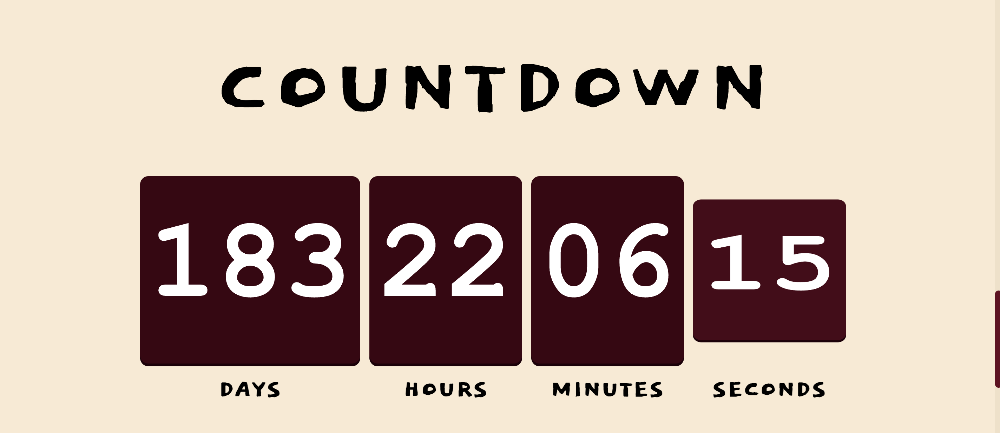
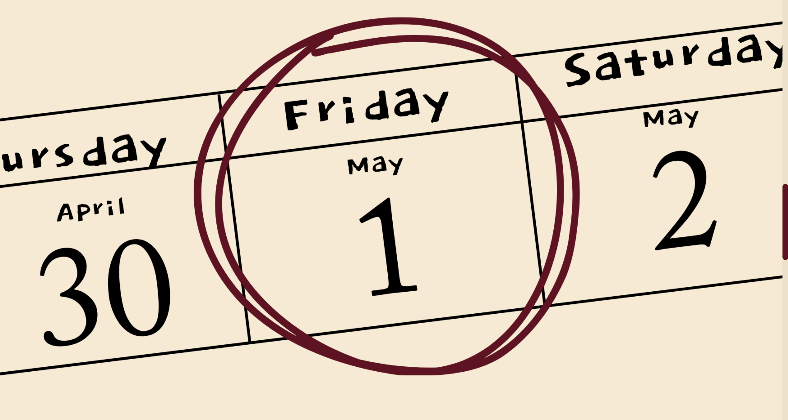
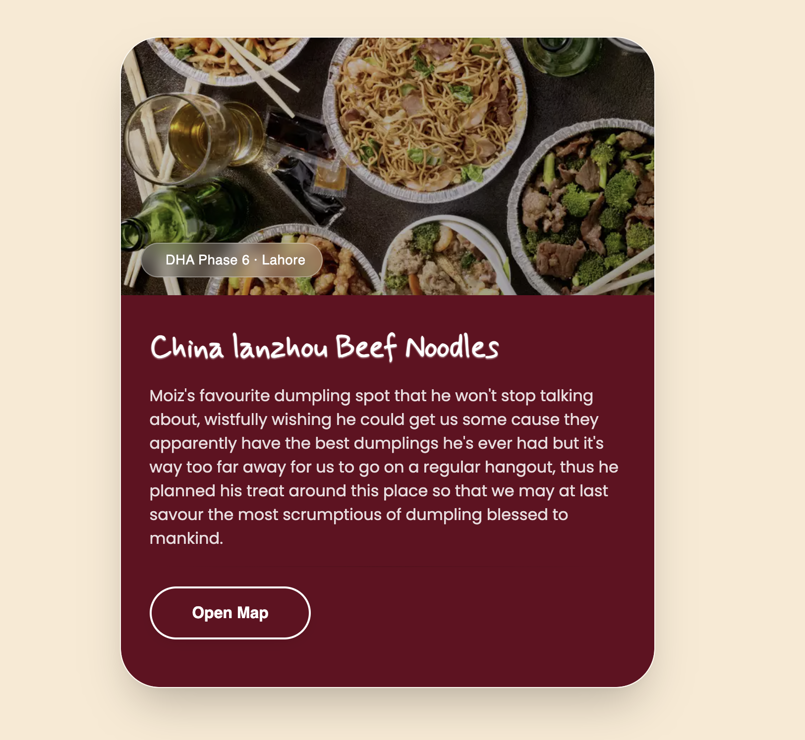

# Invitation Site

A beautiful, responsive single-page invitation site featuring a **live countdown to the event** and an **embedded Google Maps location** so guests know exactly when and where to celebrate.

---

## ✨ Features

- ⏳ **Live event countdown** — days, hours, minutes, and seconds until the big day
- 🗺️ **Google Maps embed** — interactive location so guests can get directions in one tap
- 📱 **Fully responsive** — looks great on phones, tablets, and desktops
- 🎨 **Custom styling** — elegant envelope/logo design and typography
- 🚀 **Zero build step** — pure HTML, CSS, and vanilla JavaScript

---

## 📸 Screenshots

### 🏠 Hero / Landing View
The opening view with the envelope graphic, event title, and personalized greeting.

---

### ⏳ Countdown Timer
A real-time countdown showing days, hours, minutes, and seconds remaining until the event.

 

**Event date:**

 

---

### 🗺️ Location & Google Maps
The venue details with an embedded interactive Google Map for easy navigation.

---

## 🛠️ Tech Stack

| Layer | Technology |
|-------|------------|
| Markup | HTML5 |
| Styling | CSS |
| Logic | Vanilla JavaScript |
| Hosting | GitHub Pages |

---

